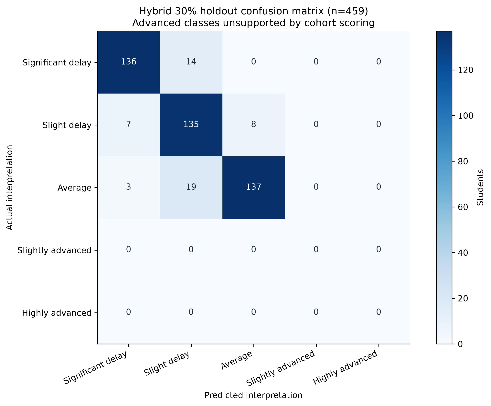
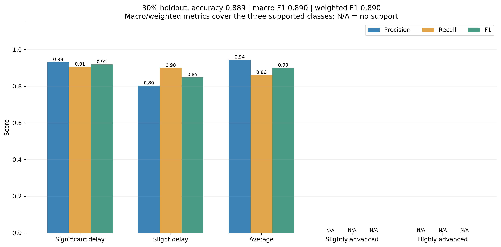
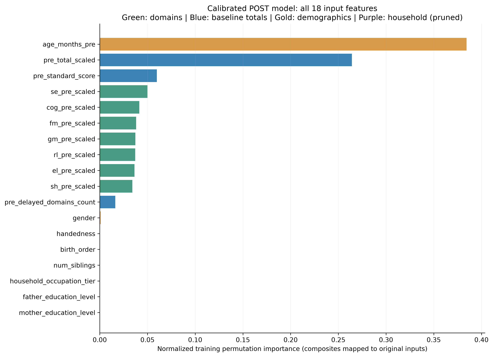
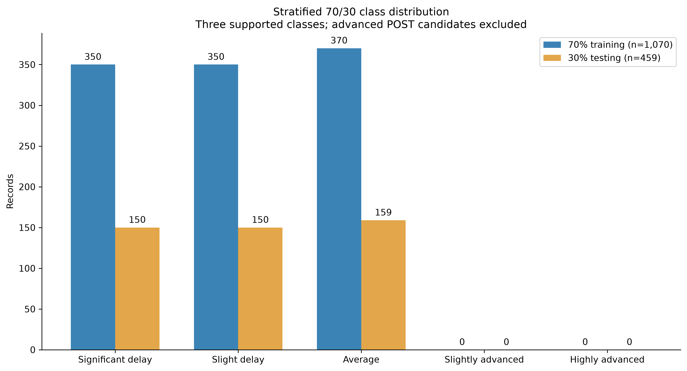
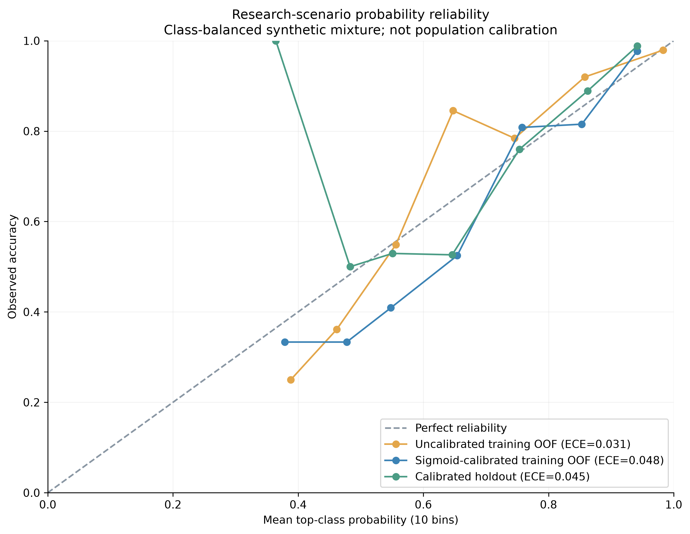

# AMES Active Machine Learning Pipeline: Defense Audit Report

**Audit date:** 2026-11-11. **Scope:** the active `backend/ml/` pipeline, fitted
artifact, evaluation records, six diagnostic plots, prescription guides, and
their API integration. This is an audit of the local repository, not a hosted
deployment assessment. No model, dataset, scoring rule, or application behavior
was changed to produce this report.

## Executive assessment

The active predictor is a **standalone Random Forest classifier with sigmoid
probability calibration**, not the historical Random Forest/HistGradientBoosting
voting hybrid. Its implementation and stored evaluation are reproducible against
the available local holdout. Its **real-world predictive usefulness is not
established**.

The most important distinction for a defense panel is the evaluation population:

| Evidence | Result | Defensible interpretation |
| --- | ---: | --- |
| Mixed holdout, mostly synthetic | 423/459 correct; **92.1569%** accuracy | Performance on the declared research scenario mixture |
| Real-only holdout | 3/8 correct; **37.5000%** accuracy | Small, development-influenced real sample; five false delay forecasts |
| Five-fold mixed training CV | **88.5981%** mean accuracy | Internal development estimate, not external validation |
| Student-excluded real predictions with shared generator anchors | 9/29 correct; **31.0345%** accuracy | Exclusion from estimator fitting does not remove generator dependence |
| Exploratory real-fold evaluation with fold-local generation | 13/29 correct; **44.8276%** accuracy | Better separation of held-out learners, but the cohort already informed development |
| Always predict Average, all real learners | 29/29 correct; **100%** accuracy | The model does not beat this simple baseline on the available real cohort |

All **29 real POST outcomes are Average**. The 1,500 synthetic records add
scenario coverage, not 1,500 independently observed children. Neither real delay
sensitivity, population probability calibration, clinical validity, nor activity
effectiveness can be established from these results. The appropriate defense
claim is an implemented and internally evaluated educational research prototype.

Activity suggestions are a separate **deterministic PRE-based rule system**.
They retrieve locally authored text from JSON; runtime selection does not call
an LLM. They require teacher review and do not constitute validated treatment.

## 1. Evidence, identity, and reproducibility

### 1.1 Evidence sources

| Evidence | What it establishes |
| --- | --- |
| [Training and evaluation script](../backend/ml/train_random_forest.py), especially `make_pipeline`, `candidates`, `select_on_training`, and `finalize` | Active configuration, CV, metrics, weighting, and artifact publication |
| [Serializable pipeline components](../backend/ml/pipeline.py) | Fold-local preprocessing, household exclusion, calibration support adjustment |
| [Dataset builder](../backend/ml/dataset_builder.py) and [feature contract](../backend/ml/common.py) | Workbook extraction rules, synthetic assumptions, predictors, target |
| [Evaluation metrics](../backend/ml/artifacts/evaluation_metrics.json) | Recorded aggregate results, parameters, versions, manifests, and baselines |
| [Inference implementation](../backend/ml/inference.py) and [ML routes](../backend/routes/ml.py) | Cached artifact use, architecture checks, readiness, and shared inference |
| [Request/response schemas](../backend/schemas/ml.py) and [official scorer](../backend/utils/eccd_scorer.py) | API validation, privacy projection, and deterministic score/age calculations |
| [Prescription rules](../backend/ml/prescriptions.py) and [guide artifact](../backend/ml/artifacts/prescriptive_guides.json) | Actual triggers, authored activities, support tiers, and recorded attribution |
| [Plot implementation](../backend/ml/plots.py) and existing PNGs in section 6 | What each visualization measures and how it is labeled |

The existing Graphify graph was consulted for navigation. It predates the active
RF integration and is not treated as an exact current dependency inventory;
current source inspection establishes the findings below.

### 1.2 Artifact and data fingerprints

The trusted local joblib bundle was loaded and its fitted nested estimator was
inspected. Its checksum matches the **top-level** `model_sha256` in the metrics
JSON, rather than a historical comparison hash nested elsewhere in that file.

| Artifact/input | Verified SHA-256 |
| --- | --- |
| `backend/ml/artifacts/rf_post_test_model.joblib` | `1ff4591f0f8e21bbaeb48f5617f61acd460f2953f6609cac52d5f86a6bdcec73` |
| `backend/ml/data/hybrid_eccd_dataset.csv` | `c96bf127e19998bf551de38d68603c91136591fe93052766a0ca819751e40a2c` |
| `backend/ml/data/train_set_70.csv` | `85d4dba9cd5d8e6ee161ca02046b0b2d56e7a87f573d623adf52fa4baaeededb` |
| `backend/ml/data/test_set_30.csv` | `3a5c93ae87afb97ba29508bccc01b2c9c566bfd1d0f73259d9f65572b8ffdd2c` |
| `backend/eccd_scoring_data.json` | `dd66c79092cbaeab0d9da39c6ed0380fb6b79987e4278279f38014a1521d22d2` |
| `backend/ml/artifacts/prescriptive_guides.json` | `4f2f8801d5176cead3fb68b2c4d0f2145f263da0249eae610c5d1369e5711721` |

Dataset/split fingerprints match the model's metadata. The pipeline component,
dataset-builder, and scoring-table source fingerprints also match the recorded
training manifest. The trainer matches its recorded fingerprint
`7a946c50a0f4071c2f5e7bfb966cf5ce3f68dd1eeaab961eb5abaa78c5841317`
after CRLF-to-LF normalization. Its raw Windows checkout fingerprint differs
because of line endings; this is not evidence of a semantic trainer change.

The bundle records Python **3.12.13** and scikit-learn **1.9.1** at training.
Joblib is pickle-based: loading the repository's trusted artifact is distinct
from accepting arbitrary user-supplied model files. The runtime loader checks
architecture and feature/class compatibility; it does not enforce the audit's
SHA-256 as an integrity allowlist.

The local CSVs were available for this audit but remain private/ignored research
assets. A normal checkout need not contain them. Their hashes and aggregates
support identification without publishing learner-level records.

## 2. Model architecture, tuning, and probability handling

### 2.1 Fitted architecture and prediction target

The inspected bundle contains a pipeline whose classifier is
`SupportAwareCalibration`, a subclass of `CalibratedClassifierCV`. Its fitted
base estimator is `FoldWeightedClassifier`, containing domain feature
engineering, a column preprocessor, and a fitted `RandomForestClassifier` with
**400 trees**. There is one fitted calibrated classifier because
`ensemble=False`.

Random Forest is itself an ensemble of decision trees. Here, **standalone**
means a single Random Forest model family, without a second model family combined
by voting or stacking. Neither `VotingClassifier` nor
`HistGradientBoostingClassifier` is the active nested base estimator. Historical
hybrid experiment files do not identify the current runtime model.

The target is `post_interpretation`, the future overall POST category:

1. Suggests Significant Delay in Overall Development.
2. Suggests Slight Delay in Overall Development.
3. Average Overall Development.

The model does not predict future raw/domain scores. Slightly Advanced and Highly
Advanced POST outcomes are unsupported; the generator counts and rejects those
candidates rather than relabeling them as Average. Runtime classification chooses
the class with the highest final probability.

### 2.2 Configuration and actual selection methodology

The active trainer evaluates the predefined candidate **`rf_full_leaf3`**, stated
in source to come from prior screening. It uses a manual candidate dictionary
and explicit CV loop, **not GridSearchCV or RandomizedSearchCV**. There is one
candidate in the current run, so it does not establish hyperparameter optimality.

| Parameter | Active value | Meaning |
| --- | --- | --- |
| `n_estimators` | `400` | Number of decision trees |
| `max_depth` | `None` | No explicit depth cap; other stopping constraints apply |
| `min_samples_split` | `2` | Minimum samples to attempt a split |
| `min_samples_leaf` | `3` | Minimum samples per terminal leaf |
| `criterion` | `gini` | Split impurity measure |
| `max_features` | `0.8` | Fraction of transformed features considered per split |
| `bootstrap` | `True` | Bootstrap sampling for trees |
| `class_weight` | `balanced` | Inverse-frequency class weighting within fitting |
| `max_samples` / `max_leaf_nodes` | `None` / `None` | No explicit subsample-size or leaf-count cap |
| `ccp_alpha` / `min_impurity_decrease` | `0.0` / `0.0` | No positive pruning/split-improvement threshold |
| `min_weight_fraction_leaf` | `0.0` | No additional weighted-fraction leaf minimum |
| `oob_score` / `warm_start` | `False` / `False` | No OOB scoring or incremental tree accumulation |
| `monotonic_cst` | `None` | No monotonic constraints |
| `random_state` / `n_jobs` / `verbose` | `42` / `1` / `0` | Reproducible seed, single worker, no verbose tree output |

Historical [training experiments](../backend/ml/artifacts/training_cv_experiments.json)
record named candidates such as `rf_depth12_leaf3`, `rf_full_leaf5`, histogram
boosting, and RF/boosting soft voting under earlier dataset manifests.
[Scenario screening](../backend/ml/artifacts/scenario_cv_screen.json) records
growth assumptions and real-sample weights. These are evidence of exploratory
screening, not an exhaustive search space or a new search performed by the active
trainer. Do not describe every active/default parameter as a parameter proven to
have been tuned.

### 2.3 Fitting weights and data separation

Real training rows have supplied sample weight **2.0** and synthetic rows **1.0**.
Within each fit, a 12-neighbor check down-weights an isolated synthetic
contradiction to **0.5** when at least nine neighbors support another class and
the local domain-score distance criterion is met. Real rows retain their supplied
weights. This modifies influence, not labels. These sample weights coexist with
the forest's balanced class weights.

Feature engineering, imputation, scaling, encoding, and neighbor-based weighting
fit within training/calibration subfolds. Holdout rows do not enter those fitted
steps. This protects estimator-level separation, but does not undo the
pre-split generator dependence described in section 3.

### 2.4 Sigmoid calibration and support adjustment

The active configuration uses `method='sigmoid'`, an inner
`StratifiedKFold(n_splits=3, shuffle=True, random_state=42)`, and
`ensemble=False`. Inner out-of-fold predictions fit classwise sigmoid mappings
(Platt-style calibration); multiclass probabilities are normalized. The base
pipeline then refits the available training rows. The five outer training folds
evaluate this complete procedure. This is internal evaluation, not a nested
hyperparameter-search validation study.

`SupportAwareCalibration` adds a second probability adjustment outside training
PRE-score ranges. For the ten PRE score/summary inputs, it measures range
overshoot in training-standard-deviation units and sets:

```text
mass = 1 - exp(-L2(standardized range overshoot))
final probabilities = (1 - mass) * sigmoid probabilities + mass * training priors
```

Age alone is excluded from that distance. Priors use the supplied training
sample weights. This heuristic expresses caution about score extrapolation;
it is not an empirically validated correction for population shift, older age,
or an individual child's recovery. No profile-specific forced category or
confidence cap is applied.

| Recorded probability diagnostic | Log loss | Multiclass Brier sum | Top-label ECE, 10 bins |
| --- | ---: | ---: | ---: |
| Uncalibrated mixed training OOF | 0.282777 | 0.158880 | 0.031370 |
| Calibrated mixed training OOF | 0.308223 | 0.161766 | 0.047990 |
| Calibrated mixed holdout | 0.229011 | 0.113920 | 0.044941 |

Lower is better for these diagnostics. **Calibration worsened all three recorded
training OOF diagnostics.** Its presence must not be presented as proof of
improved reliability. The holdout is a different evaluation population, so its
better values are not a paired before/after calibration comparison. These
research-mixture probabilities are not validated clinical confidence or
population outcome rates.

## 3. Dataset, quantitative performance, and error patterns

### 3.1 Profile, split, and cross-validation

**N = 1,529:** 29 real learners plus 1,500 synthetic scenarios, approximately
**98.10% synthetic**. The builder extracts paired PRE/MID/POST observations from
two sex-separated, Violet-labeled 2024–2025 workbook inputs. This is a small
localized cohort, not a demonstrated multi-school sample. Institutional identity
and population representativeness were not independently verified.

Synthetic generation uses real-domain covariance, observed PRE-to-POST growth,
and anchored demographics/assessment spacing. It broadens PRE profiles, applies
declared growth/noise/household assumptions, scores simulated outcomes through
the deterministic tables, and rejection-samples **500 per supported POST class**.
That balance is imposed and is not observed prevalence. The active defaults are
growth factor **0.40** and noise standard deviation **0.006**.

`train_test_split(test_size=0.30, stratify=post_interpretation, random_state=42)`
produces **1,070 training rows and 459 test rows**. The final artifact fits only
the training portion. Five shuffled, stratified outer training folds each
validate on 214 rows; three shuffled, stratified inner folds perform calibration.

| POST class | Real train | Synthetic train | Train total | Real test | Synthetic test | Test total |
| --- | ---: | ---: | ---: | ---: | ---: | ---: |
| Significant Delay | 0 | 350 | 350 | 0 | 150 | 150 |
| Slight Delay | 0 | 350 | 350 | 0 | 150 | 150 |
| Average | 21 | 349 | 370 | 8 | 151 | 159 |
| **Total** | **21** | **1,049** | **1,070** | **8** | **451** | **459** |

Real PRE ages span **59–80 completed months**; synthetic PRE ages span **36–71**.
The real holdout spans 63–75 months. Broader synthetic ages do not substitute for
observed validation in those ages.

**Independence limitation:** all 29 real learners anchored the original
generator before the mixed split. Their POST observations influenced generator
growth assumptions even though POST fields are excluded from predictors.
Consequently, mixed holdout/CV results are not independent real-cohort validation.

### 3.2 Accuracy, precision, recall, and F1

Unless stated otherwise, macro/weighted figures below use the **three supported
classes**. Percentages are rounded to four decimal places.

| Mixed holdout metric | Value |
| --- | ---: |
| Accuracy | **92.1569%** |
| Macro precision | 92.1888% |
| Macro recall | 92.1761% |
| Macro F1 | **92.1690%** |
| Weighted precision | 92.2154% |
| Weighted recall | 92.1569% |
| Weighted F1 | **92.1727%** |

| Mixed holdout class | Support | Precision | Recall | F1 |
| --- | ---: | ---: | ---: | ---: |
| Significant Delay | 150 | 94.6309% | 94.0000% | 94.3144% |
| Slight Delay | 150 | 88.3871% | 91.3333% | 89.8361% |
| Average | 159 | 93.5484% | 91.1950% | 92.3567% |

| Evaluation population | N | Accuracy | Macro F1 | Weighted F1 |
| --- | ---: | ---: | ---: | ---: |
| Mixed holdout | 459 | 92.1569% | 92.1690% | 92.1727% |
| Synthetic-only holdout | 451 | 93.1264% | 93.1429% | 93.1442% |
| Real-only holdout | 8 | 37.5000% | 18.1818% | 54.5455% |

For the real holdout, weighted precision is 100% but weighted recall is 37.5%:
only Average has true support, and all predicted Average cases are indeed
Average. This illustrates why precision alone hides five incorrect delay
forecasts. No real delayed POST outcome was available to assess sensitivity.

Mixed training CV mean accuracy is **88.5981%**, with fold standard deviation
**2.1023 percentage points**. Mean macro F1 is **88.6136%**, with standard
deviation **2.0723 percentage points**. Those deviations describe fold variation,
not confidence intervals. Fold accuracies are 85.0467%, 88.7850%, 90.1869%,
91.1215%, and 87.8505%.

The JSON also stores a five-label classification report with zero-support advanced
labels assigned zeros by `zero_division=0`. Its macro F1 is **55.3014%**, using
five labels rather than three. This denominator difference is explicit, not an
alternative headline result; advanced-class performance is **not estimable**.
Weighted averages remain unchanged because those labels have zero support.

### 3.3 ROC-AUC: additional audit computation

The active evaluation script records probability reliability metrics but does
**not** publish ROC-AUC. The following values were computed during this audit
from the unchanged, hash-matched local test CSV and fitted artifact. Probability
columns were aligned with `pipeline.classes_`, not with the display order of the
confusion matrix.

| Mixed holdout ROC-AUC definition | Value |
| --- | ---: |
| One-vs-rest, macro | **0.988428** |
| One-vs-rest, support weighted | **0.988395** |
| One-vs-one, macro | 0.988431 |
| One-vs-one, support weighted | 0.988421 |
| Significant Delay vs rest | 0.994261 |
| Slight Delay vs rest | 0.984272 |
| Average vs rest | 0.986751 |

AUC measures probability ranking across thresholds, not accuracy or calibration.
These values describe the same mostly synthetic mixture and do not establish
real delay discrimination. Real-only multiclass AUC cannot be estimated because
the observed real target contains only Average.

### 3.4 Confusion matrix and practical errors

Rows are actual outcomes; columns are predictions. The displayed order is
**Significant Delay, Slight Delay, Average**, distinct from the fitted estimator's
alphabetical probability-column order.

| Actual / predicted | Significant Delay | Slight Delay | Average | Total |
| --- | ---: | ---: | ---: | ---: |
| Significant Delay | 141 | 8 | 1 | 150 |
| Slight Delay | 4 | 137 | 9 | 150 |
| Average | 4 | 10 | 145 | 159 |
| **Total** | **149** | **155** | **155** | **459** |

The diagonal sums to 423 and errors total 36. One-vs-rest counts are:

| Class treated as positive | False positives | False negatives | Main concern |
| --- | ---: | ---: | --- |
| Significant Delay | 8 | 9 | Eight actual significant delays predicted Slight Delay; one predicted Average |
| Slight Delay | **18** | 13 | Largest false-positive count and lowest precision |
| Average | 10 | **14** | Largest false-negative count; 14 actual Average cases predicted delayed |

Combining both delay classes, **10/300** actual delayed scenarios are predicted
Average and **14/159** actual Average cases are predicted delayed. These are
research-mixture counts, not validated real screening sensitivity/specificity.
In the real holdout, all eight actual outcomes are Average: predictions are
**three Significant Delay, two Slight Delay, and three Average**. Thus all five
real errors are false delay forecasts, not observed missed real delays.

### 3.5 Baselines and real-learner evaluation designs

| Population | N | Always-Average accuracy | PRE-category persistence accuracy |
| --- | ---: | ---: | ---: |
| Mixed holdout | 459 | 34.6405% | 57.0806% |
| Synthetic holdout | 451 | 33.4812% | 57.8714% |
| Real holdout | 8 | **100.0000%** | 12.5000% |
| Entire real cohort | 29 | **100.0000%** | 13.7931% |

PRE persistence retains the observed PRE category, including advanced PRE labels;
it does not learn from POST. The forest beats these baselines on the mixed
scenario holdout, but does not beat always-Average on the real cohort.

The **9/29** shared-anchor student-excluded result combines training out-of-fold
predictions for 21 real learners and test predictions for eight. Exclusion from
fitting does not remove the generator's access to all real anchors.

The separate **13/29** exploratory evaluation uses shuffled five-fold real-learner
splits. Each fold generates 1,500 synthetic training scenarios using only its
23 or 24 real training learners, fits/calibrates there, and scores held-out real
learners. Correct counts are **3/6, 4/6, 3/6, 1/6, and 2/5**. It improves fold
separation, but all 29 learners had already informed development; it is not an
untouched external validation or a directly comparable hybrid improvement.

The final artifact also gets **22/29 (75.8621%)** on the entire real cohort, but
**21 learners overlap its training set**. This is not an unseen-performance claim.

## 4. Feature contract X and preprocessing

### 4.1 Exact 18-field input contract

This order is defined by `common.FEATURES` and enforced by `DomainFeatures`.
The API accepts 18 fields; **13 supplied fields are retained**, followed by
internal derived features. MID/POST measurements are not supplied as predictors.

| # | API field | Meaning | Estimator handling |
| --- | --- | --- | --- |
| 1 | `gm_pre_scaled` | Gross Motor PRE scaled score | Retained numeric |
| 2 | `fm_pre_scaled` | Fine Motor PRE scaled score | Retained numeric |
| 3 | `sh_pre_scaled` | Self-Help PRE scaled score | Retained numeric |
| 4 | `rl_pre_scaled` | Receptive Language PRE scaled score | Retained numeric |
| 5 | `el_pre_scaled` | Expressive Language PRE scaled score | Retained numeric |
| 6 | `cog_pre_scaled` | Cognitive PRE scaled score | Retained numeric |
| 7 | `se_pre_scaled` | Socio-Emotional PRE scaled score | Retained numeric |
| 8 | `pre_total_scaled` | Sum of seven PRE scaled scores | Retained numeric |
| 9 | `pre_standard_score` | Official-table PRE overall standard score | Retained numeric |
| 10 | `pre_delayed_domains_count` | Number of seven PRE domain scores <=6 | Retained numeric |
| 11 | `age_months_pre` | Completed months at official PRE assessment | Retained numeric |
| 12 | `gender` | `MALE` / `FEMALE`, nullable | Retained categorical |
| 13 | `handedness` | `Left` / `Right`, nullable | Retained categorical |
| 14 | `mother_education_level` | Mother's education category | **Excluded** |
| 15 | `father_education_level` | Father's education category | **Excluded** |
| 16 | `household_occupation_tier` | Household occupation category | **Excluded** |
| 17 | `num_siblings` | Sibling count | **Excluded** |
| 18 | `birth_order` | Birth-order position | **Excluded** |

API validation rejects extra fields and nonfinite numbers. Domain scaled scores
are bounded 0–19, total scaled 0–133, standard score 0–200, and delayed-domain
count 0–7. Student inference accepts age 1–216 months subject to record readiness;
the sandbox specifically requires integer **36–71** months. These validation
ranges do not imply validated model accuracy throughout those ranges.

### 4.2 Why the five household fields are dropped

The pipeline explicitly describes these fields as uncollected and removes them
before data-dependent estimator processing. They remain accepted for compatibility
with the 18-field API. They do not enter imputation, scaling, encoding, the forest,
or household missingness flags. Changing only their accepted values or missingness
must leave predictions invariant. Their zero plotted importance is structural
exclusion, not empirical evidence that household conditions are irrelevant.

**Important distinction:** synthetic generation still samples household categories
and uses education, occupation, and siblings in an illustrative growth penalty.
Birth order is sampled but does not enter that penalty directly. These are not
measured causal effects in the real cohort. Pruning household predictors does not
erase assumptions already embedded in synthetic labels, nor establish fairness
with respect to gender, age, socioeconomic status, or correlated features.

Names, LRNs, student IDs, source labels, and MID/POST measurements are excluded
from X. Source affects training weights only. Failed-item identifiers used by
guides are separate recommendation inputs, not extra estimator features.

### 4.3 Official domains and age calculation

| Official domain ID | Code | Domain | Baseline checklist item capacity |
| --- | --- | --- | ---: |
| 1 | GM | Gross Motor | 13 |
| 2 | FM | Fine Motor | 11 |
| 3 | SH | Self-Help | 27 |
| 4 | RL | Receptive Language | 5 |
| 5 | EL | Expressive Language | 8 |
| 6 | C | Cognitive | 21 |
| 7 | SE | Socio-Emotional | 24 |

For actual students, official-domain KAYA counts are converted using the existing
age-bracket lookup tables. Custom domains cannot contribute prediction dates,
features, readiness, or official scoring codes. The capacities above identify
the baseline artifact/sandbox contract, not evidence that arbitrary future
question edits have been revalidated for this model.

The dataset builder and student route calculate completed chronological months:

```text
months = 12 * (PRE.year - birth.year) + PRE.month - birth.month
         - (1 if PRE.day < birth.day else 0)
```

Age uses birth date and the official teacher-confirmed PRE date, not today's age
or a static profile field. Official scoring converts elapsed years/completed
months to decimal years rounded to one decimal with `ROUND_HALF_UP`. Sandbox
composites and internal table proxies similarly convert `age_months_pre / 12`.
The scorer uses its existing three age brackets and falls back to its oldest
bracket for older children; this does not create validated older-age norms.

### 4.4 Transformation and engineered inputs

`DomainFeatures` retains the eleven numeric fields and two categories, then adds:

| Derived input | Definition |
| --- | --- |
| `motor_composite` | Mean of GM and FM PRE scaled scores |
| `language_composite` | Mean of RL and EL scores |
| `cog_socio_composite` | Mean of Cognitive and SE scores |
| `delay_ratio` | `pre_delayed_domains_count / 7` |
| `domain_std` | Population standard deviation across seven domain scores |
| `min_domain_score` | Minimum of seven domain scores |
| `capacity_interval_mean` | Inverse-width-weighted mean of normalized official-table raw-interval midpoints |
| `capacity_interval_lower` | Maximum of normalized domain interval lower bounds |
| `capacity_interval_upper` | Minimum of normalized domain interval upper bounds |

The last three invert fixed PRE scoring-table intervals for the age bracket,
using the nearest available scaled value. They are interval **proxies**, not
recovered actual raw scores or learned POST information. Their lower/upper
summaries do not constitute a validated confidence interval.

The resulting **20 numeric columns** use training-median imputation followed by
`StandardScaler`. Gender and handedness use training-mode imputation followed by
`OneHotEncoder(handle_unknown='ignore', sparse_output=False)`. Imputers preserve
empty features and add no missingness indicators. Every fold fits these steps
locally. Standardization is part of the saved pipeline, although decision trees
do not generally require scaled units.

Student routes require complete answers in official PRE domains, an official
teacher-confirmed PRE date, and valid birth-date chronology. This does not imply
that every parent-origin answer must itself carry a teacher timestamp. Server
scoring and sandbox composite recomputation remain authoritative.

## 5. Prescription guide mechanics and provenance

### 5.1 Runtime selection and boundary cases

`load_guides()` caches the local JSON. `predict_student()` calls
`recommend(student, guides)` independently of the predicted overall POST class.
For each official domain:

```text
select guidance if PRE scaled score <= 6 OR explicit PRE DI-KAYA items exist
tier = Delay if score <= 3; Slight Delay if score <= 6; otherwise Average
```

| PRE evidence | Result |
| --- | --- |
| Score 3, no explicit failed items | Delay-tier guidance |
| Score 4–6, no explicit failed items | Slight Delay-tier guidance |
| Score 7+, explicit DI-KAYA item | Average-tier guidance for the observed gap |
| Score 7+, no explicit DI-KAYA items | No guidance for that domain |
| Score 7+, unmarked items only | No trigger from missingness alone |

Database answers use `DI-KAYA` (hyphen); `DI_KAYA` is sometimes used informally
to describe the same failed-item concept. Runtime item lists are local positions
within each official domain, not global question IDs. Unmarked items are separate
from explicit failures; they are not automatically treated as DI-KAYA.

The selected tier supplies a fixed activity, goal, scaffolding, practice schedule,
success observation, and source URL. Delay suggests daily supported practice and
review in seven days; Slight Delay suggests several sessions weekly and review
in 14 days; Average embeds practice in routines and reviews in 14 days. These
frequencies are local planning choices, not clinically validated dosages.

### 5.2 Curricular basis and limits of provenance

The JSON records **DepEd Kindergarten Curriculum Guide, May 2016**, pointing to
the [DepEd curriculum PDF](https://www.deped.gov.ph/wp-content/uploads/2019/01/Kinder-CG_0.pdf),
and describes National Early Learning Framework/developmental-domain alignment.
Its metadata identifies page 5 for the domain overview and domain-specific
sections, with an explicit **domain-level**, rather than exact-indicator, mapping.
The PDF fetch returned HTTP 403 during this audit. Its exact page mapping was
therefore not independently verified and must be presented as artifact attribution.

The official [DSWD ECCD Checklist Technical and Administration Manual catalog](https://kmportal.dswd.gov.ph/knowledge-products/how-guide/early-childhood-care-and-development-eccd-checklist-technical-and)
was accessible. It identifies the seven assessment domains and the second child
record's age range of 3 years 1 month to 5 years 11 months. This supports the
domain vocabulary and age-boundary discussion, not endorsement of AMES activities.
The [ECCD Council checklist-use PDF](https://eccdcouncil.gov.ph/wp-content/uploads/2024/10/How-to-Use-the-ECCD-Checklist-compressed.pdf)
is an additional official reference; direct fetching also returned 403, so this
audit does not claim a page-by-page review of that manual.

| AMES domain | Recorded curriculum alignment | Locally authored activity example |
| --- | --- | --- |
| GM | Physical health and gross motor development | Supervised walking path and gentle ball rolling |
| FM | Fine motor development and creative expression | Dough shapes, blocks, and short drawing strokes |
| SH | Personal care and safety | Rehearse handwashing or a familiar dressing step |
| RL | Listening comprehension | Short familiar directions with gestures/objects |
| EL | Oral expression | Picture talk and pretend play with response time |
| C | Mathematics and understanding the environment | Match, sort, and count familiar concrete objects |
| SE | Socio-emotional and values development | Name feelings and practise supported turn-taking |

These are **locally authored classroom/home suggestions**, not verbatim official
prescriptions. The repository does not establish exact ELDS indicator equivalence,
official endorsement, expert validation of each activity, or measured benefits.
The checklist/scoring framework and the curricular activity reference have
different roles; checklist alignment does not prove intervention efficacy.

### 5.3 Determinism and teacher responsibility

For identical inputs and the same guide version, selection and returned activity
text are deterministic. The forest does not generate the activity prose and no
runtime LLM call is present. This prevents runtime generative fabrication; it
does not prove the original text's authorship process or educational adequacy.

Teachers should confirm the observed gap, language accessibility, materials,
safety, and appropriateness, then record progress using ordinary assessment
procedures. Guidance is independent of research forecast correctness. Predictions
do not overwrite official assessments, and suggested activities are not recorded
as evidence that an intervention occurred or worked.

## 6. Diagnostic plot audit

All six existing PNGs were visually inspected and compared with their source
definitions and recorded results. They were not regenerated for this audit.

### 6.1 Confusion matrix



The figure matches section 3's mixed holdout counts. Its five-label frame includes
zero-support advanced rows/columns. Despite the axis label “Students,” most cells
represent synthetic scenarios, not independently observed children.

### 6.2 Classification metrics



Slight Delay has the weakest precision and F1. Advanced results correctly appear
as N/A. Headline macro/weighted metrics cover three supported classes, while
display values are rounded to fewer decimal places than this report's tables.

### 6.3 Feature importance



This is training-only permutation importance of the fitted **base forest** using
macro F1 and five repeats, not impurity importance or a held-out explanation of
the entire calibrated wrapper. Negative means are clipped to zero; derived-input
contributions are distributed equally to their source fields and normalized.
Age receives approximately **38.44%**, total PRE scaled score **26.42%**, and
PRE standard score **5.99%** of that mapped total. Household values are zero by
construction. Correlated inputs, synthetic age/outcome construction, and the
allocation convention limit causal or individual-level interpretation.

### 6.4 Class distribution



Counts agree with the 350/350/370 training and 150/150/159 test distribution.
The chart combines real and synthetic rows; it does not show real delayed POST
examples or estimate class prevalence in the school population.

### 6.5 Real PRE versus POST comparison

[View the real-cohort PRE/POST comparison](../backend/ml/artifacts/plots/05_real_beneficiary_pre_vs_post_comparison.png).
The existing chart uses pseudonymous learner codes; this report does not copy a
learner-level table. Its y-axis represents ordinal categories, not continuous
standard scores. All observed POST categories are Average. The model series is
the **9/29 shared-anchor student-excluded** series, not the separate 13/29
fold-local-generator experiment. Observed PRE-to-POST change cannot be attributed
causally to the model or its suggested activities.

### 6.6 Probability reliability



The three curves use ten top-label confidence bins. Recorded ECE is about 0.031
uncalibrated OOF, 0.048 calibrated OOF, and 0.045 calibrated holdout. Sparse bins
can vary substantially. The chart explicitly describes a class-balanced research
mixture, not population calibration, and does not establish a calibration benefit.

## 7. Limitations, defense risks, and mitigation

| Risk / limitation | Evidence and implication | Current boundary or recommended mitigation |
| --- | --- | --- |
| Synthetic dominance and generator dependence | 1,500/1,529 rows are simulated; all real learners anchored the original generator | Lead with source-specific results; freeze model/generator before a new independent cohort |
| Very small, localized real cohort | 29 real learners from one paired workbook collection; no demonstrated multi-school sampling | Recruit additional schools and cohorts; verify sampling/institutional provenance; do not infer national validity |
| No real delayed POST outcomes | All 29 real targets are Average | Report delay sensitivity and real multiclass AUC as unestimable; collect observed outcome diversity |
| Failure to beat the real baseline | Real holdout 3/8 versus always-Average 8/8 | Acknowledge lack of demonstrated predictive benefit; compare against simple baselines in future validation |
| Non-independent development evidence | Repeated use of the cohort and historical scenario/configuration screening | Reserve untouched external/temporal validation data; generate scenarios strictly within training partitions |
| Imposed class balance | 500 synthetic rows per supported class | Do not translate class probabilities into school prevalence; assess calibration against observed deployment prevalence |
| Calibration and extrapolation uncertainty | OOF diagnostics worsen; support blending is heuristic | Disclose results; independently compare raw/calibrated predictors before a separately authorized model revision |
| Age and scoring-norm limits | Real PRE ages reach 80 months; oldest scorer bracket is reused; synthetic ages end at 71 | Disclose fallback and stratify future evaluation by age; do not claim new older-age norms |
| Unsupported advanced outcomes | Advanced POST candidates excluded, never learned | Keep the supported-class scope explicit; broaden only with an authorized, validated training study |
| Household assumptions and unassessed fairness | Inputs pruned, but synthetic growth includes household penalties; age/gender remain | Label assumptions; assess subgroup errors and scenario sensitivity with adequate real data |
| Question/scoring compatibility | Fixed artifact relies on official domains and baseline scoring structure | Review compatibility when checklist content or scoring tables change; do not assume new questions are model-validated |
| No causal activity-effect evidence | Retrospective paired assessments, no randomized or controlled activity evaluation | Describe educational planning suggestions; evaluate activity delivery and outcomes separately |
| Limited guide provenance granularity | Domain-level attribution; no exact competency crosswalk or efficacy study | Obtain educator review and a documented competency mapping before stronger claims |
| Private reproducibility inputs | Full CSVs are local/ignored; raw extraction was not rerun | Retain protected authorized data and manifests; provide aggregates and bounded reproduction instructions |

**Study design wording:** these records include paired PRE/MID/POST observations,
so describing the dataset as purely cross-sectional would be inaccurate. The
model learns a tabular PRE-to-POST classification relationship from a small
retrospective cohort plus scenarios. It is not an independently validated
prospective longitudinal study, and it cannot separate maturation, teaching,
measurement changes, or intervention effects.

**Publication policy:** current publication gates check fitted RF architecture,
sigmoid calibration, the feature/class contract, household invariance, and finite
normalized probabilities. Historical >=90% accuracy/F1 gates and selected-profile
probability bands are diagnostics, not current publication requirements. Mixed
CV accuracy and macro F1 are below 90%. Passing publication checks establishes
artifact compatibility, not educational effectiveness.

### 7.1 Panel questions and recommended answers

| Likely panel question | Evidence-based response |
| --- | --- |
| “Is this an ensemble or a Random Forest?” | “It is one Random Forest model family, internally composed of 400 trees, with sigmoid calibration. The earlier RF/boosting voting hybrid is not the active model.” |
| “Was it optimized through grid search?” | “The active run evaluates one previously screened configuration using five-fold training CV. It does not run GridSearchCV or RandomizedSearchCV, and we do not claim global optimality.” |
| “Does 92% accuracy mean it works for real children?” | “That result is from a mostly synthetic holdout. The real holdout is 3/8, and reliable real-world usefulness is not established.” |
| “Why did you use synthetic data?” | “It provides declared research scenarios across three outcomes absent from the small real cohort. It does not replace independent observed children or prove population performance.” |
| “Can it detect developmental delay?” | “Synthetic scenario discrimination is measured. Real delayed POST outcomes were absent, so real delay sensitivity cannot be estimated.” |
| “Why does a constant prediction beat your model?” | “All real POST outcomes are Average. Always-Average gets 29/29; the model makes false delay forecasts. We disclose that failure rather than treating class imbalance as an accuracy ceiling.” |
| “Did calibration improve reliability?” | “Sigmoid calibration is implemented, but the recorded OOF log loss, Brier score, and ECE worsen. We do not equate calibration's presence with demonstrated improvement.” |
| “What do the probabilities mean?” | “They are model scores calibrated on the research mixture, with an additional support heuristic. They are not validated individual recovery rates or clinical certainty.” |
| “Why collect 18 fields if five are ignored?” | “The interface remains compatible, but five uncollected household fields are pruned before estimator preprocessing. Household assumptions still affect synthetic generation, which is a separate limitation.” |
| “Are the suggested activities generated by AI?” | “Runtime suggestions retrieve fixed local text by PRE domain score and observed failed items. There is no runtime LLM generation; the text still needs educator review.” |
| “Are the activities officially prescribed by DepEd?” | “They are locally authored suggestions with recorded domain-level curriculum alignment, not official prescriptions or proven treatments.” |
| “Is this a cross-sectional or longitudinal study?” | “The source records have paired assessment periods, but the current evidence is retrospective and development-influenced. We have not established prospective longitudinal validity or causality.” |
| “What is the system's contribution today?” | “It integrates deterministic official assessment with a reproducible research predictor and transparent planning rules. Predictive benefit and intervention effectiveness remain research questions.” |
| “What would justify stronger claims?” | “A frozen protocol, independent multi-school/temporal data with real outcome diversity, baseline comparisons, subgroup evaluation, and separate intervention-effect studies.” |

### 7.2 Runtime boundaries already implemented

Source inspection shows cached shared teacher/parent inference, no runtime
training/refitting, and no prediction writes to official assessment records.
Official-domain completeness and a teacher-confirmed PRE date gate student
inference. Parent predictions additionally require eligible linked-child access,
the adviser prediction permission, and independent PRE release. Parent response
schemas omit family model inputs and individual checklist marks/item lists.
Unavailable/incompatible artifacts yield a sanitized 503. These are implementation
properties; authorization routes and production deployment were not exercised
against a database during this documentation audit.

## 8. Verification record and read-only reproduction

### 8.1 Checks executed versus evidence inspected

During this audit, the trusted fitted bundle and local CSVs were loaded without
calling `fit`. Model/data hashes, class distributions, age ranges, tree count,
calibrator configuration, and source manifests were inspected. Predictions on
the unchanged holdout reproduced **423/459** accuracy and the displayed matrix;
macro/weighted precision, recall, and F1 were checked against recorded metrics.
ROC-AUC was additionally computed with the fitted probability-column order.
Guide construction/selection and household invariance were checked without
writing model outputs. All six existing plots were visually inspected.

Full training, synthetic generation, raw-workbook extraction, and CV were **not
rerun**. CV, exploratory folds, historical screening, and probability diagnostics
are recorded evidence cross-checked against their current implementation, not
new experimental runs. Existing ML tests were inspected as supporting context;
no full backend/frontend suite, database migration, or hosted deployment test
was needed or run for this documentation-only change. No dependencies were added.

### 8.2 Reproduce holdout and guide checks without training

From the repository root, use the existing Python 3.12 environment. This requires
the authorized local CSVs matching the fingerprints above. The code reads trusted
artifacts, predicts, and prints aggregates; it does not save artifacts or refit.

```powershell
@'
import hashlib
import json
from pathlib import Path

import numpy as np
import pandas as pd
from sklearn.metrics import accuracy_score, confusion_matrix, roc_auc_score
from sklearn.metrics import precision_recall_fscore_support

from backend.ml.common import ACTIVE_CLASSES, FEATURES, TARGET
from backend.ml.inference import load_guides, load_model
from backend.ml.prescriptions import build_guides, recommend

root = Path("backend/ml")
metrics = json.loads((root / "artifacts/evaluation_metrics.json").read_text())
digest = lambda path: hashlib.sha256(path.read_bytes()).hexdigest()
expected = "1ff4591f0f8e21bbaeb48f5617f61acd460f2953f6609cac52d5f86a6bdcec73"
assert digest(root / "artifacts/rf_post_test_model.joblib") == expected
assert metrics["model_sha256"] == expected
for name, key in [("hybrid_eccd_dataset.csv", "dataset_sha256"),
                  ("train_set_70.csv", "train_sha256"),
                  ("test_set_30.csv", "test_sha256")]:
    assert digest(root / "data" / name) == metrics["metadata"][key]

bundle = load_model()
model = bundle["pipeline"]
test = pd.read_csv(root / "data/test_set_30.csv")
X = test[FEATURES]
probabilities = model.predict_proba(X)
predicted = model.classes_[probabilities.argmax(axis=1)]
assert np.isfinite(probabilities).all()
np.testing.assert_allclose(probabilities.sum(axis=1), 1)
matrix = confusion_matrix(test[TARGET], predicted, labels=ACTIVE_CLASSES)
assert matrix.tolist() == metrics["supported_confusion_matrix"]
assert int(np.trace(matrix)) == 423
assert np.isclose(accuracy_score(test[TARGET], predicted),
                  metrics["holdout"]["accuracy"])
for average in ("macro", "weighted"):
    values = precision_recall_fscore_support(
        test[TARGET], predicted, labels=ACTIVE_CLASSES,
        average=average, zero_division=0)[:3]
    for suffix, value in zip(("precision", "recall", "f1"), values):
        assert np.isclose(value, metrics["holdout"][f"{average}_{suffix}"])
    print("ROC-AUC OvR", average, roc_auc_score(
        test[TARGET], probabilities, labels=model.classes_,
        multi_class="ovr", average=average))
print("confusion matrix", matrix.tolist())

changed = X.copy()
changed["mother_education_level"] = "College"
changed["father_education_level"] = "Elementary"
changed["household_occupation_tier"] = "Professional"
changed["num_siblings"] = 7
changed["birth_order"] = 8
np.testing.assert_allclose(model.predict_proba(changed), probabilities,
                           rtol=0, atol=0)

guides = load_guides()
assert guides == build_guides()
profile = {key: 7 for key in FEATURES[:7]}
assert not recommend(profile, guides)
assert not recommend({**profile, "gm_pre_unmarked_items": "1"}, guides)
for score, tier in [(3, "Delay"), (4, "Slight Delay"), (6, "Slight Delay")]:
    result = recommend({**profile, "gm_pre_scaled": score}, guides)
    assert len(result) == 1 and result[0]["tier"] == tier
result = recommend({**profile, "gm_pre_di_kaya_items": "1"}, guides)
assert len(result) == 1 and result[0]["tier"] == "Average"
assert result == recommend({**profile, "gm_pre_di_kaya_items": "1"}, guides)
print("holdout, household invariance, and deterministic guide checks passed")
'@ | uv run --no-project --python .venv312 python -
```

Do not use the training script, including `--cv-only`, as a read-only verification
command: it writes selection/split or evaluation artifacts. A separately
authorized retraining study must preserve the active model and establish a new
manifest and validation protocol.

### 8.3 Audit boundary

This report adds documentation only. Application/API contracts, scoring,
permissions, durable drafts, datasets, and model/guide/plot artifacts remain
unchanged. The review introduced no new abstraction, application state, or
dependency. The remaining scientific limitations require new independent evidence,
not stronger wording around the existing results.
